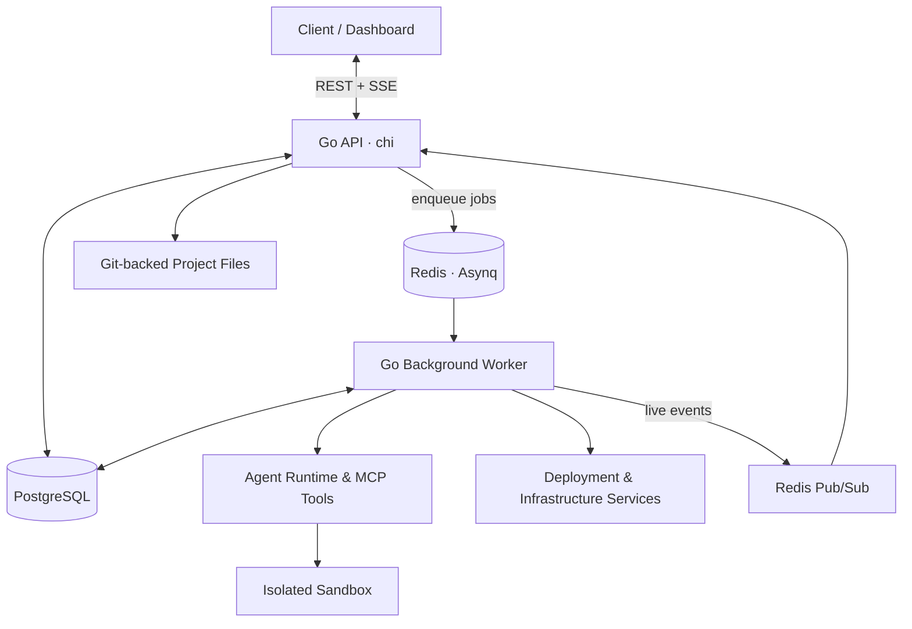

# Vonop Backend

**A Go backend for AI-assisted application building, asynchronous execution, and cloud deployment.**

Vonop Backend is a production-oriented backend codebase built around a modular Go application and separate background workers. It brings together REST APIs, concurrent job execution, real-time event streaming, PostgreSQL persistence, agent tooling, and automated application deployment.

The repository is published as an **engineering reference**: a look at how these concerns fit together in a real application, rather than a plug-and-play starter kit.

## Highlights

- **Go API and service architecture** — REST endpoints with [chi](https://github.com/go-chi/chi), interface-driven integrations, organization-aware resources, authentication, and billing workflows.
- **Asynchronous jobs** — Redis-backed [Asynq](https://github.com/hibiken/asynq) workers for agent runs, deployment tasks, scheduled jobs, retries, and cancellation.
- **Concurrency and real-time updates** — goroutines, channels, mutex-protected SSE fan-out, Redis Pub/Sub, and PostgreSQL-persisted milestones for reconnect and replay.
- **Agent execution** — multi-step tool use, MCP integrations, human approval, context and memory handling, Git-backed checkpoints, and isolated sandbox operations.
- **Application infrastructure** — Git-backed project files, Dockerized builds, Fly.io deployment, Caddy routing, database provisioning through Neon, and S3-compatible asset storage.
- **Observability** — structured logging, OpenTelemetry traces, Langfuse integration, product events through PostHog, and targeted integration tests.

## Technology stack

| Area | Technologies |
| --- | --- |
| Language & HTTP | Go 1.25, chi, REST, SSE |
| Data | PostgreSQL, Bun ORM, Redis |
| Background processing | Asynq, goroutines, channels, Redis Pub/Sub |
| Agent infrastructure | MCP, tools, approval workflows, Daytona |
| Deployment | Docker, Docker Compose, Fly.io, Caddy, Neon, AWS S3 |
| Observability | OpenTelemetry, Langfuse, Better Stack, PostHog |
| Testing | Go testing, Testcontainers |

## Architecture

The API and worker share application services but run as separate processes. Redis handles the job queue and live event transport; PostgreSQL stores application state and the durable milestones needed to recover after a disconnected stream.



### Execution and recovery

1. The API accepts a request, enforces execution limits, and creates a tracked background job.
2. An Asynq worker executes the task. Agent and deployment events are published to Redis.
3. The API forwards live events over SSE. Significant milestones are also stored in PostgreSQL.
4. If a client disconnects, it can recover persisted milestones instead of relying exclusively on ephemeral Pub/Sub messages.

Live event delivery is best-effort; persisted state is the source of truth for recovery. This separation keeps the streaming path responsive without treating Redis Pub/Sub as durable storage.

## Explore the implementation

For readers interested in Go backend design, these are good entry points:

| Code | What it demonstrates |
| --- | --- |
| [`cmd/main.go`](cmd/main.go) | HTTP API entry point and route setup |
| [`cmd/worker/main.go`](cmd/worker/main.go) | Asynq queues, retry policies, scheduled work, and graceful shutdown |
| [`internal/controllers/event_bus.go`](internal/controllers/event_bus.go) | Thread-safe SSE fan-out using buffered channels and `sync.RWMutex` |
| [`internal/jobstate/flusher.go`](internal/jobstate/flusher.go) | Non-blocking state persistence using goroutines and synchronization |
| [`internal/services/jobstream/jobstream.go`](internal/services/jobstream/jobstream.go) | Redis Pub/Sub for stream events, cancellation, and approval decisions |
| [`internal/agent/run.go`](internal/agent/run.go) | Context-bounded agent execution and checkpoint lifecycle |
| [`internal/agent/tools_mcp.go`](internal/agent/tools_mcp.go) | MCP tool execution and human-in-the-loop approvals |
| [`internal/database/testdb_integration.go`](internal/database/testdb_integration.go) | Container-backed database test setup |

## Build and development

**Requirements:** Go 1.25.4+, Docker for integration tests, PostgreSQL, Redis, and credentials for the configured external services.

```bash
git clone https://github.com/knid/vonop-backend.git
cd vonop-backend

go mod download
make build
make worker

# API and worker, in separate terminals once configuration is available:
make dev
make worker-dev
```

Run ordinary Go tests with:

```bash
go test ./...
```

Database-backed integration tests use Testcontainers and require Docker:

```bash
make test-integration
```

**Configuration note:** The application bootstrap expects Infisical authentication and configured services. This repository does not include a ready-to-use local secrets configuration. `docker-compose-dev.yaml` assumes an existing `.env.dev` and only defines the API and PostgreSQL; Redis and other dependencies must be configured separately. Tests that exercise external integrations may need provider credentials.

**Deployment note:** `docker-compose.yaml` and some build settings contain environment-specific image references and networking configuration. Treat them as examples of the original deployment architecture, not as generic production manifests.

## Repository status

This is a public reference codebase, not a fully generalized self-hosted distribution. The repository was renamed to **vonop-backend**, while the Go module and some internal identifiers still use their original names. They have not been refactored solely to match the repository name.

The codebase illustrates practical Go backend engineering, especially concurrency, fault-aware background work, event streaming, and the infrastructure surrounding agentic applications.
